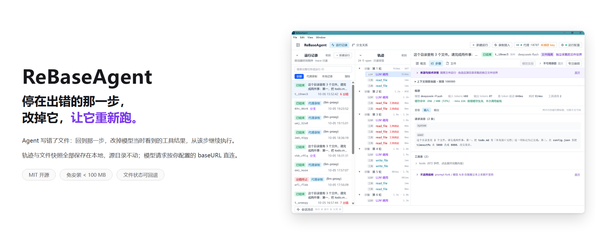
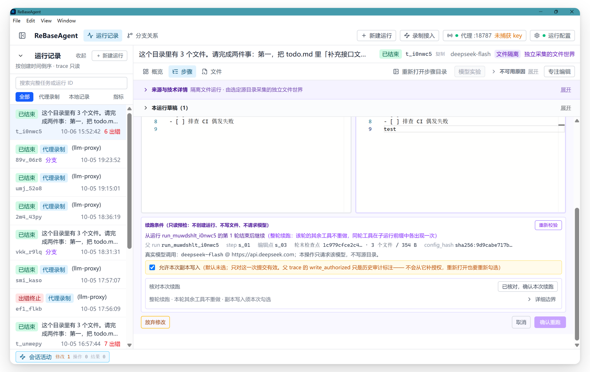
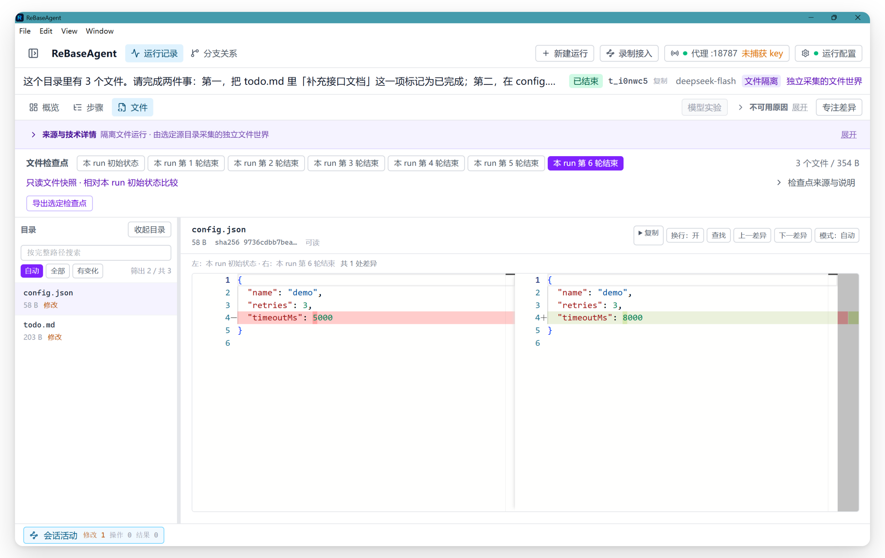
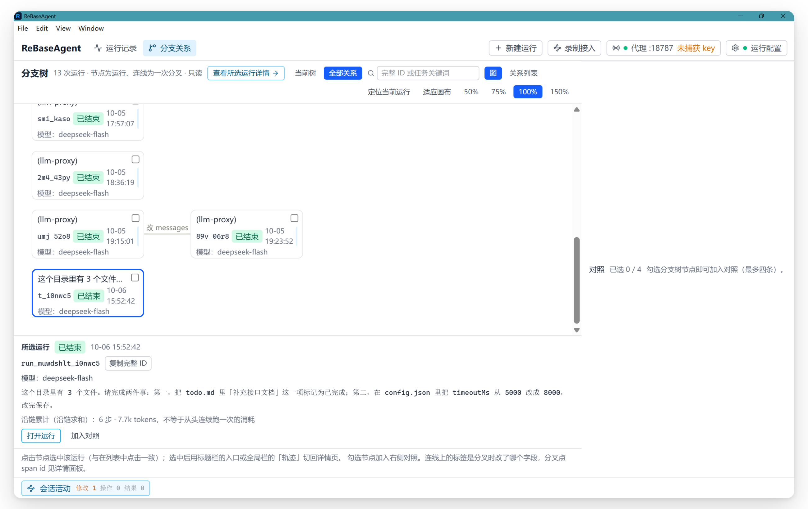

<div align="center">

<p>English | <a href="README.md">简体中文</a></p>


# ReBaseAgent

🐟 **Not just replay what your agent did — rerun it from the step that went wrong.** ⏪✨

<p>
  <a href="LICENSE"></a>
  <a href="https://github.com/pomelotea-yuzu/ReBaseAgent/releases/tag/v0.7.0-rc.2"></a>
  <a href="https://www.electronjs.org/"></a>
  <a href="https://react.dev/"></a>
  <a href="https://www.typescriptlang.org/"></a>
  
  <a href="CONTRIBUTING.en.md"></a>
</p>

</div>



## 🧭 What it is

Debugging multi-turn file tasks has a concrete problem: **after restoring historical messages, later tools still read files from the current directory**, so the continuation starting point cannot be explained.

Within this project's execution loop and controlled `read_file` / `write_file` tools, ReBaseAgent maps an edit of a tool observation to the **file snapshot at the end of the whole turn**, then continues in an isolated branch. Editing a tool result changes only what the model sees; it does not undo that turn's writes or re-execute the edited tool.

| Traditional debugging | ReBaseAgent |
| ---------------- | -------------------------------- |
| 📊 Profiler | Context-budget map (where tokens went) |
| ✏️ Change a line of code and rerun | Edit one step's `tool_result` and rerun from that step |
| 🔁 Regression tests | Trace-as-Test replay |
| 🌿 `git diff` | Locate the fork point between two runs |

Compared with LangGraph checkpoint forking and Langfuse / Phoenix prompt experiments and retries, this project's technical notes focus on **message/file-state alignment, branch isolation, and failure-rejection boundaries**. For a comparison with related approaches, see the [landscape research](docs/research/2026-09-27-agent-debugging-landscape.md) (Chinese) and [mechanism notes](docs/architecture/replay-state-consistency.md) (Chinese). Cross-product performance and effectiveness still need same-task validation.

## 📥 Download

**Windows x64 portable** → [GitHub Releases](https://github.com/pomelotea-yuzu/ReBaseAgent/releases/tag/v0.7.0-rc.2) / [Gitee Releases](https://gitee.com/yuzu-tea-duck/re-base-agent/releases/tag/v0.7.0-rc.2)

The latest package is **0.7.0-rc.2** (fix candidate): distributed as a **zip** (`ReBaseAgent-0.7.0-rc.2-win-x64.zip`, `100,711,965` bytes, SHA-256 prefix `46bf35061f7338b0`), containing `ReBaseAgent-0.7.0-rc.2-win-x64-portable.exe` (`95,140,470` bytes), a **read-only `mcp/` diagnostics directory** (13 tools since v0.7.0; see the [MCP guide](docs/guide/mcp-readonly-diagnostics.en.md)), a per-file `SHA256SUMS.txt`, and usage notes. Extract with 7-Zip / WinRAR and double-click the exe; no installation is required. App data lives in `data/` next to the exe — carry that directory when moving the app. The portable launcher uses a temporary extraction directory; "portable" does not mean "creates no temporary files".

> 0.7.0-rc.2 is a rebuild of 0.7.0-rc.1: feature scope is unchanged (R3 isolated project verification + 13 MCP tools); it fixes **rc.1's same-millisecond root run ID collision** (which could overwrite historical run records) and several Linux/root/slow-machine CI compatibility issues. **Uploaded to GitHub / Gitee Releases (maintainer-confirmed 2026-10-28)**; automated gates and offline smoke tests are green, but manual on-device acceptance has not been performed (see the [build record](docs/engineering/reports/2026-10-26-v0.7.0-rc.2-build-record.md) (Chinese)). The historical stable release [v0.2.0](https://github.com/pomelotea-yuzu/ReBaseAgent/releases/tag/v0.2.0) is not a long-term support commitment; see [SECURITY.en.md](SECURITY.en.md) for support scope.

> Prefer 7-Zip / WinRAR: it does not add the Mark-of-the-Web flag, avoiding the first SmartScreen "unknown publisher" prompt. With built-in extraction, click "More info → Run anyway" if prompted (this project has not purchased a code-signing certificate).

## 🚀 What it can do



**⏪ Edit one step and rerun from it** — Stop at the step you want to change, edit the tool result the model saw at that point, and continue from that step. Context before the fork point is stitched together locally (zero API calls); only what comes after the branch point actually calls the model. The resent prefix may hit the provider's prefix cache. Measured on a 3-call run with the last step edited: **1** request, 484 input tokens with **256** cached, and a full-price cost of **21%–40%** of the parent run.



**🛡️ Rerun even when the run had write tools** — This is the most practical difference from debuggers that can only look. Create an isolated run with file checkpoints from a directory, edit one step's tool result, and continue from **that turn's copy of the file world**: the parent run, source directory, and sibling branches remain byte-for-byte unchanged; sibling tools from the same turn keep their original effects and are not replayed. Files are content-addressed and shared across runs, so the whole data directory stays readable and forkable after being moved.

**🔀 Change the startup context and rerun from the beginning** — Edit the system prompt or the first user message, then run the whole task again with a newly recorded trace; the parent run remains for provenance, and branches can be compared side by side. A changed startup context cannot reuse the prefix, so this is a new experiment, not a same-source replay.

**🧪 Verify a fix in a fixed environment** — Take source code from a historical checkpoint and run the fixed `node-ts-v1` template's typecheck or trusted tests in a restricted Docker Desktop (Linux containers) container. Environment preparation and execution are confirmed separately; outcome, evidence completeness, logs, and artifacts are recorded separately, and two verifications can be compared side by side. The tested input can be exported under the R2.1 contract. Only Windows x64 + Docker Desktop + `node-ts-v1` are supported; custom commands, dependencies, images, or limits are rejected. Verification never triggers a model repair automatically.



**⚖️ Compare two behaviors** — Search and locate branches; two runs can be checked in the full comparison workspace for edits, output, steps, and metrics, and two to four runs can be viewed in a metrics table. The UI shows per-arm facts and deltas relative to the parent; it does not pick a winner.

**🧪 Keep a record that can be replayed** — Use a sealed trace as a cassette and rerun it locally with your current agent-loop and tool declarations: a zero-API Agent runtime regression test that can run in CI (see [`packages/trace-test`](packages/trace-test)). The CLI provides `rebaseagent-trace-test` and `rebaseagent-model-ab`.

**💰 See the context budget** — Visualize where tokens went by message and tool. `llm.call` records `cache_hit` / `cache_miss`, and the run list directly shows whether this call's prefix saved anything.

**🔍 Diagnose failures** — When a model call fails, a redacted, length-limited `error` is recorded (message plus HTTP status when known): the trace tree marks the node in red, the detail view gives the reason and status code, and states that tokens / latency are placeholder zeros. Older traces without this field show "error details not recorded" rather than inventing a cause.

**💾 Do not lose debug drafts** — After switching steps, runs, settings, or closing the editor, the original text (including empty strings and invalid JSON) is kept for the session by edit target, so you can return and fix it after a failure.

**📚 Read even when the parent chain is missing** — Only when ancestor files are confirmed missing, the app shows the validated current run record with an explicit note that the parent chain is incomplete and inherited content is unknown. Corrupt or unsupported versions are still rejected.

<details>

<summary>Full capability list (source-code view, including boundaries and limitations)</summary>

### Desktop

- **Span timeline** — Inspect each iteration, each LLM call, each tool execution, and the full context the model actually saw at the time
- **Monaco inline editing** — Offline, self-hosted; view and edit any step's `tool_result` directly
- **Native run creation** — Use **New run** in the desktop app to open the creation workspace, fill in a task, verify the model configuration, and run a run (empty tool table, pure conversation) without a proxy or scripts. The resulting root run can directly serve as the parent for prompt fork / model A/B / trace-test
- **Local LLM recording proxy and recording workspace** — Configure the proxy from **Recording access**, verifying enabled, actually listening, and captured key separately; copy only the verified listening address. Point the app's `base_url` at that address and keep the original key to record. **Edit messages and resend** opens an isolated workspace that resends one model request only; it does not execute external tools or restore the external app's working directory
- **Execution and result loop** — Active operations are registered, deduplicated, and given a single execution slot by the main process; status can be checked across pages, and when unknown the app verifies first, then reads results or locates failures by trusted run ID. Background completion does not steal the current page; closing a panel does not stop execution
- **Model A/B experiments** — Batch-replace model / sampling parameters from the same parent run, executing arms sequentially with independent recordings. The experiment workspace first gets a dry-run plan from the backend, then confirms cost; editing an arm or saving/clearing model configuration invalidates the old plan. Results keep success, failure, missing arms, and unreadable facts; two to four can enter the shared comparison

### Packages and CLI

CLI (all support `--help`; exit codes 0 = success / 1 = execution failure / 2 = configuration error):

```bash
# Trace-as-Test: cassette rerun regression (zero network, zero cost, CI-friendly)
rebaseagent-trace-test tests/agent.trace.test.jsonl --config agent.config.mjs

# Model A/B: dry-run the plan first (no key, no network), then execute for real (billed per actual call; arms are not requests; requires REBASEAGENT_API_KEY)
rebaseagent-model-ab --parent <runId> --dir <tracesDir> \
  --arm "deepseek-chat;temperature=0.2" --arm "deepseek-chat;temperature=1.5" \
  [--dry-run | --confirm-cost]
```

### How time travel works

```text
Go back to step N = look up the recorded request of the Nth llm.call (zero API calls)
Edit             = modify that step's tool_result
Rerun            = continue from step N (prefix stitched locally, zero calls; real API calls only after the branch point)
                   the resent prefix may hit the provider's prefix cache (measured: 3 calls → 1 call, 484 input tokens with 256 cached)

prompt fork = edit the startup context of the first llm.call (system prompt / first user message)
Rerun       = execute the whole task from step 1 (startup context changed, prefix cannot be reused — a new experiment, not a same-source replay)
```

### Three kinds of "rerun"

| | Normal rerun / prompt fork | **Isolated file rerun** | Trace-as-Test cassette |
| -------- | ----------------------- | ------------------ | ---------------- |
| Where files come from | Host disk (`exec.cwd`) | The snapshot's **copy world** | Not involved |
| How tools execute | Handler supplied by the caller | Fixed `file-tools-v1` | Not executed; recorded results are consumed one by one |
| Can file state go back? | ❌ Not promised | ✅ Back to the end-of-turn state of the fork turn | — |
| Makes real LLM calls | Normal rerun: after the fork; prompt fork: from the beginning | Yes (after the branch point) | No (zero network, zero cost) |
| Suitable for | Pure conversation / read-only tools | **Runs with write tools** | Sealed traces as regression cases |

> Isolated rerun preserves only the **content of controlled regular files** (logical path + original bytes). File permissions, timestamps, symlink identity, network, and databases are **not** preserved.

### Current limitations (honest disclosure)

- Only **Windows x64** is built; macOS / Linux packages do not exist yet
- **Integration is still manual**: native runs require configuring a model in **Settings**; external agents can integrate the SDK or point `base_url` at the recording proxy. Automatic discovery of external projects is not provided
- Time travel currently supports **editing `tool_result` (rerun from that step, shared prefix) and editing the startup context (system prompt / first user message, rerun from the beginning)**; editing arbitrary intermediate historical messages in the execution loop is not supported, and the proxy messages workspace only resends a single request
- **Drafts and reading positions are restored only within a session**: reloading the renderer or restarting the app does not restore draft text, reading preferences, or execution authorization. The operation registry is for verification; it does not implement true cancellation, real-time step push, a task queue, or recovery across main-process restarts
- prompt fork **bills from the beginning**: changing the startup context means the prefix cannot be reused, and hitting the parent run's prompt cache is not promised (the provider decides)
- Proxy-recorded runs now derive `config_hash` from the request body (when a string system message and a parseable tool table exist), so they **can serve as parents for prompt fork / model A/B**; recordings without a string system message (no derivable fingerprint) still cannot, and can only use "edit messages and resend"
- **The file workspace diff applies only to "text and readable" attachments**: binary attachments show only size and hash; when an attachment is missing on disk or its hash/length does not match the manifest, the UI marks **attachment missing / attachment corrupt** and refuses to show content (it does not fall back to empty text or the source directory); when neither side has content, no empty editor is rendered. The file view is read-only throughout and has **no** "apply / write back to source directory" entry
- **prompt fork and model A/B on isolated parents are not supported**: the UI says "not supported in this release" with a reason, and bypassing the UI to send IPC directly is rejected in main / the kernel; normal parents are unaffected. R2.2 opens **prompt experiments on an isolated root's initial snapshot**, not prompt fork on an isolated branch
- **Isolated prompt experiments accept only a valid root baseline**: the root must be sealed, have a complete source, use the fixed `file-tools-v1`, and its first request must contain a string system/user message; mid-chain result/v3 branches can only navigate back to a validated root. Experiment runs write v3 records; v3 parents cannot become normal prompt forks; isolated model A/B is still unsupported
- R2.2 has shipped in `v0.6.0-rc.1`. In validation scenarios involving failures / missing attachments / missing parent chains / old responses, binary and over-limit per-side states are still covered by unit tests (`write_file` accepts only strings, so the desktop path cannot trigger them naturally); visual readability, font size, and other subjective items still need manual pre-release acceptance. See the [archived scenario evidence](openspec/changes/archive/2026-10-22-add-isolated-prompt-experiments/evidence-index.md) (Chinese)
- Isolation is **not a permission system**: the copy-write authorization only means "agree to write into the copy"; it does not change access permissions on the source directory, nor does it provide isolation for shells, arbitrary handlers, external networks, or databases
- **Normal rerun** reuses messages before the fork point; tool calls produced after the fork execute for real according to configuration and may cause external side effects, with no guarantee of external-state rollback. Use **isolated file rerun** when historical file state is required; it preserves only the **content of controlled regular files** and does not promise to restore RAG, memory, databases, or arbitrary API state
- The CLI model A/B initially accepts only parent runs with an **empty tool table** (pure conversation); use the desktop app for experiments with tools
- **Failure reasons cover only model calls in the app**: proxy-recorded runs do not write `llm.call` when the upstream returns non-2xx, so such failures have no call-level details (the UI shows "error details not recorded"); redaction is **best effort** — it covers this configuration's apiKey / baseURL credentials and Authorization, Bearer, and URL-credential forms, but does not promise to find every secret in arbitrary business text
- **Shell behavior in narrow windows**: the three workspace columns are resizable (navigation 220–360 px, file directory 200–320 px, detail column at least 480 px; auto-collapse does not override manually adjusted widths). Viewports ≤800 px enter the narrow tier (directory collapsed, diff forced inline). The isolated creation screen and rerun confirmation can scroll and wrap in narrow windows, and long paths wrap (tested), but deeper responsive shell work for even narrower viewports is still in progress

</details>

## ⌨️ Quick start

Three paths — choose the one that matches what you have:

| What you want to do | Which path |
| --------------- | --------------------------- |
| See what it can do first | [Run a pure-conversation run](#run-a-pure-conversation-run) |
| Debug an agent that changes files | [Isolated file run](#use-a-run-with-write-tools-isolated-file-run) |
| Debug your existing agent | [SDK instrumentation](#debug-an-existing-agent) |

### Run a pure-conversation run

Click **New run** in the global bar or the **Run records** title bar, fill in the task in the creation workspace, and verify the model configuration; expand advanced settings to edit the system prompt. You can then run a run (empty tool table, pure conversation).

- No proxy, no code, and no external app integration required
- The resulting run is a root run (`parent` / `fork` are `null`) with `config_hash`, and can directly serve as a parent for **prompt fork / model A/B / trace-test**
- If baseURL / apiKey / model are not configured in **Settings**, the app stops before sending any request
- When a model call fails, a viewable run is still written to disk (the list badge shows "terminated with error"); failures are not silent

To run an agent that **changes files** and make it "go back and rerun", see the next section.

### Use a run with write tools: isolated file run

In the **New run** creation screen, switch the mode to **Isolated file run** to let an agent that **changes files** "go back and rerun":

1. **Choose a source directory** — Uses the native system directory picker. The collected scope is **all supported regular files under that directory (including hidden files)**; links, non-regular files, disk roots, and paths inside the data directory are rejected. First-release limits are fixed and not configurable: **2,000 files / 8 MiB per file / 64 MiB total snapshot / 128 MiB new content per run / path 512 characters, 32 segments**.
2. **The source directory is not modified** — File content goes only into **immutable attachments** in the data directory (content-addressed, shared across runs); later fork writes go only into their own copy mappings. To verify, compare the source directory after a run.
3. **Know what will be sent to the model** — Isolated mode always uses the `read_file` / `write_file` tool group, and **text read by these tools enters the model request you configured** (the creation screen shows the current `model` and `baseURL`); billing is by actual usage. Do not put files you do not want read into the source directory.
4. **Copy writes are confirmed for each execution** — The **Allow copy writes for this execution** checkbox is **unchecked by default** and **valid only for this submission**: re-entering the creation screen, switching modes, or reselecting a directory invalidates it. Choosing a directory ≠ authorization; historical authorization on the parent run **cannot** replace this confirmation (main verifies independently again).
5. **Rerun is two-phase** — Click **Rerun here (isolated continuation)** on a tool call in an isolated run: first **verify rerun conditions** (read-only preflight; no file writes, no model requests). The confirmation area shows the **direct parent run, local turn number, end-of-turn checkpoint** (first 12 characters of the snapshot fingerprint + file count/bytes), and the model that will actually be called; then check the copy-write authorization and submit. Continuation uses **whole-turn** boundaries — other tool results from the edited turn's round appear once as a shared prefix and are **not redone**.
6. **Inspect file state per turn** — On the **Files** page, switch between **Initial state / End of turn N** checkpoints and view a **text diff against the initial snapshot**. Path search, change filtering, and reading-position restoration are supported. The entire view is read-only: it does not write files, fill snapshots, call models, or write back to the source directory; binary, missing, and corrupt attachments are explained separately and never rendered as "empty files".

> The "local turn number" uses the run's own recorded turn number: if run B forks after run A's 3 turns, it shows "run B, turn 1", not an accumulated "turn 4".

### Change one startup instruction and rerun from the initial snapshot (isolated prompt experiment)

> **Shipped in `v0.7.0-rc.2` (13 tools)**: the zip includes a self-contained `mcp/` directory (`node mcp/dist/cli.js --data-dir <data-root>`); see the [MCP guide](docs/guide/mcp-readonly-diagnostics.en.md) for integration and boundaries.

In the overview or the first `llm.call` detail of an isolated root run with files, click **Edit startup instruction** to change the system prompt or the first user message and rerun from the root run's **initial file snapshot**:

1. **Edit one item only** — Edit either system or user, not both; changing both is rejected. Use consecutive forks of a normal prompt for combined experiments; isolated experiments accept only a root baseline and cannot stack edits on an isolated branch.
2. **Verify read-only first** — Verify the root run, initial file list, fixed tool group, baseline model and parameters, current endpoint / execution limits / budget, and historical unknowns and billing unknowns. Verification does not call models, write files, or occupy an execution slot; its conclusion is not an execution credential.
3. **Confirm current authorization separately** — Cost confirmation and **Allow copy writes for this execution** are unchecked by default and bound to the current configuration revision and plan fingerprint; changing input, changing configuration, leaving, or collapsing the page invalidates the old confirmation and requires re-verification.
4. **Execute for real from step 1** — The new run writes a v3 experiment record (initial source, old/new values, hypothesis, human criteria); model and parameters are fixed to the root's first request, and endpoint and credentials use current settings. The parent run, sibling branches, and source directory remain unchanged.
5. **Verify results** — The result page shows **this intervention** and **comparison with the baseline**; the comparison file view fixes each side's own checkpoint and shows cross-run file differences by path; **Export this side's checkpoint** exports only the selected side. The UI does not automatically declare "fixed" or score human criteria.

> Failures, missing attachments, missing parent chains, unknown operations, and late responses have all been verified on-device; evidence for the real-model loop, Electron geometry / scaling / real keyboard, and fault injection is in the [archived scenario evidence](openspec/changes/archive/2026-10-22-add-isolated-prompt-experiments/evidence-index.md) (Chinese). prompt fork and model A/B on isolated parents (branches) remain disabled, and bypassing the UI to send IPC directly is rejected in main / the kernel.

### Debug an existing agent

Instrument your loop with the SDK and write traces into the desktop app's data directory (for the portable build, `data/traces/` next to the exe by default):

```ts
import { JsonlTracer } from "@rebaseagent/trace-sdk";

const tracer = new JsonlTracer("traces/r_01.jsonl");
tracer.startRun({
  id: "r_01", format_version: 1, task: "Read the README and write a summary",
  model: "deepseek-chat", created_at: new Date().toISOString(),
  parent: null, fork: null, config_hash: "sha256:...",
});

const step = tracer.startSpan({ kind: "agent.step", n: 1 });
const llm = tracer.startSpan({ kind: "llm.call", parent: step, request });
tracer.endSpan(llm, { response });
tracer.endSpan(step);

tracer.endRun({ event: "stopped", reason: "completed", at: 1 });
```

Format details: [`packages/trace-sdk`](packages/trace-sdk).

### Use the execution engine too

`@rebaseagent/agent-loop` is a pure TypeScript Agent execution engine that speaks the OpenAI-compatible protocol directly, with **zero vendor SDKs**:

```ts
import { runLoop, parseRunConfig, OpenAiCompatClient } from "@rebaseagent/agent-loop";
import { JsonlTracer } from "@rebaseagent/trace-sdk";

const config = parseRunConfig({
  baseURL: "https://api.deepseek.com/v1",
  apiKey: "sk-...",
  model: "deepseek-chat",
  systemPrompt: "You are a file assistant.",
  tools: [/* OpenAI function-calling subset */],
  maxIterations: 25,
  budget: { maxTotalTokens: 100_000 },
});

const result = await runLoop(
  config,
  [{ role: "system", content: config.systemPrompt }, { role: "user", content: "Read the README" }],
  new JsonlTracer("traces/r_01.jsonl"),
  tools,
  new OpenAiCompatClient(config),
);
```

OpenAI-compatible endpoints such as DeepSeek / GLM / Qwen / Kimi work out of the box.

## 🗺️ Roadmap

**Delivered capabilities** are listed under **What it can do** above. Per-version iteration records (including each preview package's exact boundaries) are in [CHANGELOG.md](CHANGELOG.md) (Chinese); current version and hash evidence are in [project status](docs/development/project-status.md) (Chinese).

**Next up**:

- R3 real-project integration (currently only the fixed `node-ts-v1` template) and visual/keyboard/narrow-window on-device acceptance for the verification panel
- Trace bundle export (take the whole trajectory with you; distinct from the delivered file-snapshot export)
- prompt fork and model A/B on isolated parents / branches (still disabled; R2.2 opens only isolated prompt experiments on a root's initial snapshot)
- macOS / Linux packaging

**MCP service line**: MCP0 (interface and integration preparation) and MCP1 (read-only queries for runs / steps / comparisons / historical files, seven tools) shipped in `v0.6.0-rc.1`; MCP2 (R3 verification-record queries, six new tools, 13 total) shipped in `v0.7.0-rc.2` (the zip includes an `mcp/` directory; see the [integration guide](docs/guide/mcp-readonly-diagnostics.en.md)); MCP3 (on-demand controlled execution) is still planned. See the [MCP service roadmap](docs/product/mcp-service-roadmap.md) (Chinese) and the [formal roadmap](docs/product/evolution-roadmap.md) (Chinese).

Scope and boundaries: see the [split plan](docs/engineering/plans/2026-09-21-ui-change-split-plan.md) (Chinese).

## 🧱 Architecture

```text
packages/
  agent-loop   Agent execution engine (pure TS, zero Electron dependencies, headless)
  trace-sdk    Span instrumentation API + trace format v1/v2 definitions
  llm-proxy    Local model recording proxy and request resend
  replay       Replay orchestrator + sandbox manager (CI-friendly)
  trace-test   Trace-as-Test: cassette rerun runtime regression tests (zero network / zero disk, CI-friendly)
apps/
  desktop      Electron desktop debugging workbench (the only Electron-dependent package; replaceable)
```

- **Storage**: JSONL is the single source of truth, one file per run, append-only; once the terminal event is written the run is sealed and no path may modify it
- **Model access**: OpenAI-compatible protocol directly, zero vendor SDKs
- **Data policy**: portable-first — all data lives in `data/` next to the app directory, never in AppData or the registry

For modules and data flow, see [docs/architecture/overview.md](docs/architecture/overview.md) (Chinese); for the full documentation index (product / engineering records / on-device acceptance evidence), see [docs/README.md](docs/README.md) (Chinese).

## 💻 Development

```bash
pnpm install
pnpm check:build    # build shared libraries first for development
pnpm dev            # start the desktop app
pnpm test           # vitest (zero API cost, all mock-injected)
pnpm build          # build all packages (including desktop frontend assets)

# CI quality gate: the same command chain as cloud CI (Gitee Go pipeline .workflow/ci.yml)
pnpm check:ci       # = check:build → check:typecheck → check:test → check:lint → check:spec

pnpm --filter @rebaseagent/desktop dist   # package the Windows portable exe
```

The two build commands serve different purposes: `pnpm check:build` (the first step of `check:ci`) builds only the `packages/*` library artifacts for tests and cross-package consumption; `pnpm build` is the full build and additionally bundles the desktop `electron-vite` frontend for local development. They are not interchangeable.

CI configuration: **Gitee Go and GitHub Actions** (see `.workflow/ci.yml` and `.github/workflows/ci.yml`; configured to run on pushes to main and on PRs, with zero secrets). Both call the same `pnpm check:ci`. The GitHub Actions configuration has been added locally but has not been verified online; Gitee keeps historical gate records, which cannot be used to infer that the latest commit passed.

This project uses [OpenSpec](https://github.com/Fission-AI/OpenSpec) for Spec-Driven Development — each capability starts with a spec (proposal → review → implementation → archive); see the `openspec/` directory.

## 🤝 Contributing

Issues and PRs are welcome: development environment and workflow are in [CONTRIBUTING.en.md](CONTRIBUTING.en.md); quality gates and the OpenSpec workflow are in [docs/development/workflow.md](docs/development/workflow.md) (Chinese). For security issues, do not use a public issue; see [SECURITY.en.md](SECURITY.en.md). A [Gitee mirror](https://gitee.com/yuzu-tea-duck/re-base-agent) is available for mainland China networks.

Governance and responsibilities: [governance notes](docs/development/governance-and-maintenance.md) (Chinese); version support: [maintenance policy](docs/development/maintenance-policy.md) (Chinese); release and handoff: [release guide](docs/development/release-and-handoff.md) (Chinese); dependency licenses: [third-party notices](docs/development/third-party-notices.md) (Chinese).

## 📄 License

MIT
